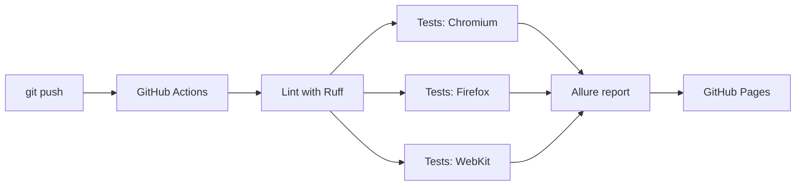
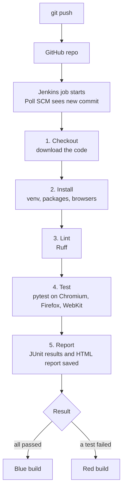

<p align="center">
  
</p>

<p align="center">
  <a href="https://github.com/divesh-sys/playwright-saucedemo-automation/actions/workflows/ci.yml"></a>
  
  
</p>

<p align="center">
  <a href="https://divesh-sys.github.io/playwright-saucedemo-automation/"><b>📊 Live Allure Report</b></a> &nbsp;•&nbsp;
  <a href="https://github.com/divesh-sys/playwright-saucedemo-automation/actions"><b>⚙️ CI/CD Runs</b></a> &nbsp;•&nbsp;
  <a href="#-demo"><b>🎬 Demo Video</b></a> &nbsp;•&nbsp;
  <a href="#-quick-start"><b>🚀 Quick Start</b></a>
</p>

<p align="center">
  
</p>

---

## 💡 About the project

An end-to-end UI test automation framework for the public demo shop [saucedemo.com](https://www.saucedemo.com). It automates the main user journeys: **login, product browsing and sorting, cart management and checkout**.

It is built the way a real automation framework is structured: reusable page objects, shared fixtures, parametrized data, cross-browser execution, and automated pipelines that run the tests and publish the results.

## ✨ Highlights

| | |
|---|---|
| 🧩 **Page Object Model** | One class per page keeps the tests short and easy to maintain |
| 🌐 **Cross-browser** | Every test runs on Chromium, Firefox and WebKit |
| 🏷️ **Test markers** | Run `smoke` or `regression` suites on demand |
| 🔁 **Parametrized tests** | Several data sets covered by one test function |
| 📸 **Rich failure data** | Screenshots, Playwright traces and Allure attachments on failure |
| ⚙️ **Two CI/CD pipelines** | GitHub Actions (`ci.yml`) and Jenkins (`Jenkinsfile`) |
| 📊 **Live reporting** | Allure dashboard published automatically to GitHub Pages |
| 🎥 **Video recording** | Headed runs recorded through a manual workflow |

## 🧰 Tech stack

<p>
  
  
  
  
  
  
  
</p>

## 🎬 Demo

https://github.com/user-attachments/assets/21d75cc0-65f2-409a-ab51-3b5524907412

### 📊 Allure report

<p align="center">
  
</p>

## 🔄 CI/CD pipelines

<p align="center">
  
</p>

Both pipelines run the same stages on every push: **lint, test on 3 browsers, report**.

<details>
<summary><b>⚙️ GitHub Actions pipeline</b> (<code>.github/workflows/ci.yml</code>)</summary>

<br>



| Stage | What happens |
|---|---|
| Lint | Ruff checks code style, and the pipeline stops if it fails |
| Test | The suite runs in parallel on Chromium, Firefox and WebKit |
| Artifacts | HTML reports are always saved, traces and screenshots are saved on failure |
| Report | Results from all browsers are merged into one Allure report and published to GitHub Pages |

Triggers: push and pull request to `main`, every weekday morning, and manual start.
A second workflow, `headed-video.yml`, runs the tests in headed mode on a virtual display and records a video of every test.

</details>

<details>
<summary><b>🛠️ Jenkins pipeline</b> (<code>Jenkinsfile</code>)</summary>

<br>



| Stage | What happens |
|---|---|
| Checkout | Jenkins downloads the latest code from GitHub |
| Install | Creates a virtual environment, installs `requirements.txt` and the Playwright browsers |
| Lint | Ruff checks code style, and the build stops if it fails |
| Test | pytest runs 14 tests on 3 browsers (42 executions) and writes `reports/junit.xml` |
| Report | Test results, the HTML report, traces and screenshots are archived with the build |

**Run it yourself**

1. Install Java 17 or later and download `jenkins.war` from [jenkins.io](https://www.jenkins.io/download/).
2. Start Jenkins and open `http://localhost:8080`:
   ```bash
   java -jar jenkins.war --httpPort=8080
   ```
3. Create a **Pipeline** job: Definition **Pipeline script from SCM**, SCM **Git**, this repository URL, branch `*/main`, Script Path `Jenkinsfile`.
4. In the `Jenkinsfile`, change the `PYTHON` value to the path of Python 3.12 on your machine, then click **Build Now**.

</details>

## ✅ Test coverage

| Area | Scenarios |
|---|---|
| 🔐 Login | valid login, locked-out user, invalid credentials (3 parametrized cases), logout |
| 🛍️ Inventory | product count, price sorting low to high and high to low, cart badge updates |
| 🛒 Cart | remove an item from the cart, open a product details page |
| 💳 Checkout | full end-to-end purchase, required field validation |

## 🚀 Quick start

**Requirements:** Python 3.12 and Git.

```bash
# 1. Clone the repository
git clone https://github.com/divesh-sys/playwright-saucedemo-automation.git
cd playwright-saucedemo-automation

# 2. Create and activate a virtual environment
python -m venv .venv
.venv\Scripts\activate          # Windows
# source .venv/bin/activate     # Mac / Linux

# 3. Install dependencies and browsers
pip install -r requirements.txt
playwright install

# 4. Run the tests
pytest
```

<details>
<summary><b>🧪 Useful commands</b></summary>

<br>

| Goal | Command |
|---|---|
| Run all tests | `pytest` |
| Smoke tests only | `pytest -m smoke` |
| Regression tests only | `pytest -m regression` |
| Use another browser | `pytest --browser firefox` |
| Watch the browser | `pytest --headed --slowmo 700` |
| Record videos | `pytest --video on` |
| Save traces for every test | `pytest --tracing on` |

</details>

<details>
<summary><b>📑 Reports</b></summary>

<br>

- **pytest HTML report:** open `reports/report.html`
- **Playwright trace viewer:** `playwright show-trace test-results/<test-folder>/trace.zip`
- **Allure dashboard:** `allure serve allure-results` (requires the Allure command-line tool)

</details>

<details>
<summary><b>📁 Project structure</b></summary>

<br>

```
playwright-saucedemo-automation/
├── assets/                 # README graphics
├── pages/                  # Page objects (login, inventory, cart, checkout)
├── tests/                  # Test suites and shared fixtures (conftest.py)
├── .github/workflows/
│   ├── ci.yml              # Lint, cross-browser tests, Allure report to GitHub Pages
│   └── headed-video.yml    # Manual headed run with video recording
├── Jenkinsfile             # Jenkins pipeline (declarative)
├── pytest.ini              # Configuration, markers, report options
└── requirements.txt
```

</details>

## 👤 Author

**Divesh Jadhav** · [GitHub: divesh-sys](https://github.com/divesh-sys)

<p align="center">
  If you find this project useful, a ⭐ on the repo is appreciated.
</p>
