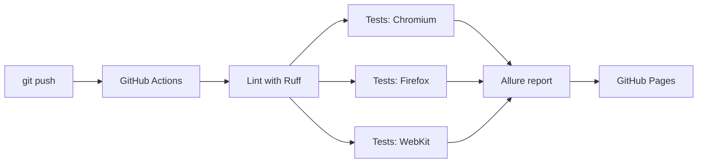
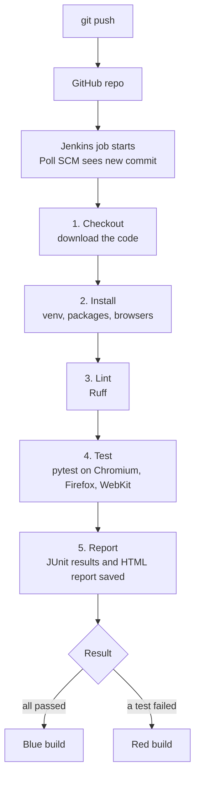

<h1 align="center">Python + Playwright + pytest end-to-end tests for an e-commerce site: 42 automated runs on Chromium, Firefox and WebKit, with CI/CD in GitHub Actions and Jenkins and a live Allure report</h1>

<p align="center">
  End-to-end UI test automation framework for the <a href="https://www.saucedemo.com">SauceDemo</a> web shop,<br>
  with cross-browser execution, CI/CD pipelines in GitHub Actions and Jenkins, and a live Allure report.
</p>

<p align="center">
  <a href="https://github.com/divesh-sys/playwright-saucedemo-automation/actions/workflows/ci.yml"></a>
  
  
  
  
</p>

<p align="center">
  <a href="https://divesh-sys.github.io/playwright-saucedemo-automation/"><b>Live Allure report</b></a> ·
  <a href="https://github.com/divesh-sys/playwright-saucedemo-automation/actions"><b>CI/CD runs</b></a> ·
  <a href="#demo"><b>Demo video</b></a>
</p>

---

## About the project

This project automates the main user journeys of a demo e-commerce site: logging in, browsing and sorting products, managing the cart and completing a purchase. It is built the way a real test automation framework is structured, with reusable page objects, shared fixtures, parametrized data, cross-browser runs and an automated pipeline that publishes the results.

## Highlights

- **Page Object Model** for maintainable, reusable test code
- **Cross-browser testing** on Chromium, Firefox and WebKit
- **14 automated tests** (42 executions across 3 browsers) with `smoke` and `regression` markers
- **Parametrized tests** to cover several data sets with one test function
- **Reporting:** Allure dashboard, pytest HTML report, screenshots and Playwright traces on failure
- **CI/CD with GitHub Actions:** lint, parallel browser matrix, automatic report publishing to GitHub Pages
- **Video recording** of headed runs through a manual workflow
- **Two pipelines:** GitHub Actions (`ci.yml`) and Jenkins (declarative `Jenkinsfile`) run the same tests

## Tech stack

| Purpose | Tool |
|---|---|
| Language | Python 3.12 |
| Browser automation | Playwright |
| Test runner | pytest, pytest-playwright |
| Reporting | Allure, pytest-html |
| Code quality | Ruff |
| CI/CD | GitHub Actions, GitHub Pages, Jenkins |

## Demo

https://github.com/user-attachments/assets/21d75cc0-65f2-409a-ab51-3b5524907412

### Allure report


## CI/CD pipeline (GitHub Actions)

The pipeline is defined in [`.github/workflows/ci.yml`](.github/workflows/ci.yml). It runs on every push and pull request to `main`, every weekday morning, and on demand.



| Stage | What happens |
|---|---|
| Lint | Ruff checks code style, and the pipeline stops if it fails |
| Test | The suite runs in parallel on Chromium, Firefox and WebKit |
| Artifacts | HTML reports are always saved, traces and screenshots are saved on failure |
| Report | Results from all browsers are merged into one Allure report and published to GitHub Pages |

A second workflow, `headed-video.yml`, runs the tests in headed mode on a virtual display and records a video of every test. It is started manually from the Actions tab.

## Jenkins pipeline

The repository also contains a [`Jenkinsfile`](Jenkinsfile), so the same tests can run on a Jenkins server. Jenkins checks GitHub for new commits, runs the stages below, and records the results.



| Stage | What happens |
|---|---|
| Checkout | Jenkins downloads the latest code from GitHub |
| Install | Creates a virtual environment, installs `requirements.txt` and the Playwright browsers |
| Lint | Ruff checks code style, and the build stops if it fails |
| Test | pytest runs 14 tests on 3 browsers (42 executions) and writes `reports/junit.xml` |
| Report | Test results, the HTML report, traces and screenshots are archived with the build |

### Run it yourself

1. Install Java 17 or 21 and download `jenkins.war` from [jenkins.io](https://www.jenkins.io/download/).
2. Start Jenkins and open `http://localhost:8080`:
   ```bash
   java -jar jenkins.war --httpPort=8080
   ```
3. Create a **Pipeline** job with these settings:
   - Definition: **Pipeline script from SCM**
   - SCM: **Git**, repository URL of this project, branch `*/main`
   - Script Path: `Jenkinsfile`
4. In the `Jenkinsfile`, change the `PYTHON` value to the path of Python 3.12 on your machine, then click **Build Now**.

GitHub Actions and Jenkins run the same project, so the tests can be executed with either tool.

## Test coverage

| Area | Scenarios |
|---|---|
| Login | valid login, locked-out user, invalid credentials (3 parametrized cases), logout |
| Inventory | product count, price sorting low to high and high to low, cart badge updates |
| Cart | remove an item from the cart, open a product details page |
| Checkout | full end-to-end purchase, required field validation |

## Project structure

```
playwright-saucedemo-automation/
├── pages/                  # Page objects (login, inventory, cart, checkout)
├── tests/                  # Test suites and shared fixtures (conftest.py)
├── .github/workflows/
│   ├── ci.yml              # Lint, cross-browser tests, Allure report to GitHub Pages
│   └── headed-video.yml    # Manual headed run with video recording
├── Jenkinsfile             # Jenkins pipeline (declarative)
├── pytest.ini              # Configuration, markers, report options
└── requirements.txt
```

## Run it locally

**Requirements:** Python 3.12 and Git.

```bash
# 1. Clone the repository
git clone https://github.com/divesh-sys/playwright-saucedemo-automation.git
cd playwright-saucedemo-automation

# 2. Create and activate a virtual environment
python -m venv .venv
.venv\Scripts\activate          # Windows
# source .venv/bin/activate     # Mac / Linux

# 3. Install dependencies and browsers
pip install -r requirements.txt
playwright install
```

### Useful commands

| Goal | Command |
|---|---|
| Run all tests | `pytest` |
| Smoke tests only | `pytest -m smoke` |
| Regression tests only | `pytest -m regression` |
| Use another browser | `pytest --browser firefox` |
| Watch the browser | `pytest --headed --slowmo 700` |
| Record videos | `pytest --video on` |
| Save traces for every test | `pytest --tracing on` |

### Reports

- **pytest HTML report:** open `reports/report.html`
- **Playwright trace viewer:** `playwright show-trace test-results/<test-folder>/trace.zip`
- **Allure dashboard:** run `allure serve allure-results` (requires the Allure command-line tool)

## Author

**Divesh Jadhav** · [GitHub: divesh-sys](https://github.com/divesh-sys)

If you find this project useful, a star on the repo is appreciated.
